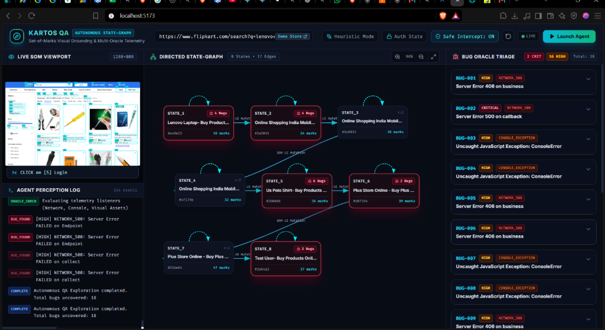
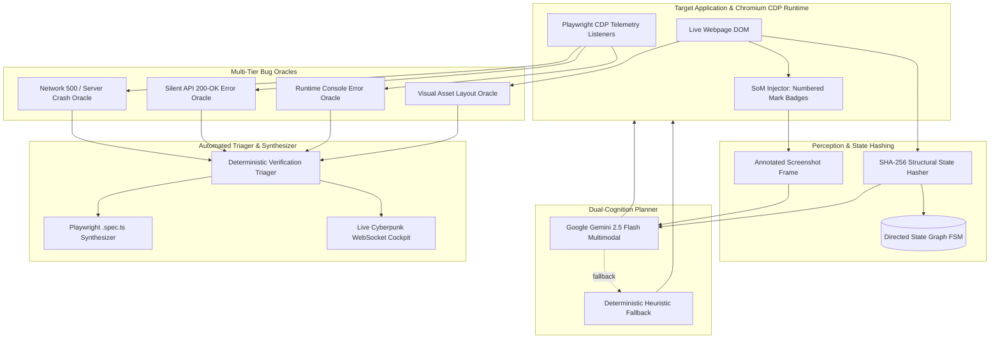

# 🚀 Kartos QA: Autonomous State-Graph & Visual-Grounding AI QA Engine

[](https://python.org)
[](https://fastapi.tiangolo.com)
[](https://playwright.dev)
[](https://react.dev)
[](https://vitejs.dev)
[](https://tailwindcss.com)
[](https://ai.google.dev)
[](LICENSE)

> A production-grade **Autonomous AI QA System** that replaces brittle linear test scrapers (`Crawl -> Prompt -> Script -> Crash`) with a **Closed-Loop, State-Graph (FSM) & Visual-Grounding Engine**.

---

## 📸 Live Engineering Dashboard Preview


*The Kartos 3-Column Cockpit: **Live Set-of-Marks Viewport** (Left), **Interactive Directed State-Graph FSM** (Center), and **Verified Multi-Oracle Bug Triage with Auto-Synthesized Playwright `.spec.ts` Tests** (Right).*

---

## ⚡ Key Paradigm Shifts (Basic vs. Advanced)

| Capability | Basic Hackathon Scraper | Kartos Autonomous Production Engine |
|---|---|---|
| **DOM Perception** | Scraping raw HTML (token bloat, fails on dynamic React/Shadow DOM). | **Set-of-Marks (SoM) Visual Grounding:** Injects numbered coordinate badges `[1]`, `[2]` over interactive nodes to eliminate selector hallucination. |
| **Navigation** | Blind linear link clicking. | **Dynamic Directed State-Graph ($G = (V, E)$):** Tracks UI mutations, modals, and drawers using deterministic SHA-256 structural DOM hashing. |
| **Test Generation** | Generating brittle upfront scripts that break on any CSS change. | **Closed-Loop Verification Loop:** Validates determinism and auto-synthesizes self-contained Playwright `.spec.ts` reproduction tests. |
| **Bug Detection** | Crashing only on unhandled HTTP 500s. | **Multi-Tier Telemetry Oracle:** Detects HTTP 500s, silent GraphQL 200-OK `"errors"`, uncaught console `TypeError`s, and broken images (`naturalWidth === 0`). |
| **Auth & Safety** | Only testing public pages; risking live DB corruption. | **One-Click Interactive Session Recorder:** Bypasses 2FA/OTPs with `storageState.json` + **Playwright Route Interception** (mocks destructive requests). |
| **Reliability** | Breaks if API keys rate-limit or fail on stage. | **Dual-Cognition Planner:** Gemini 2.5 Flash Vision reasoning with an intelligent **Deterministic Heuristic Explorer Fallback** for zero-cost, 100% offline uptime. |

---

## 🏛 System Architecture



---

## 🛠 Core Architectural Modules

### 1. Hybrid Perception Engine (`som_injector.py`)
- Evaluates the DOM to find all visible interactive elements (`button`, `a`, `input`, `select`, `textarea`, `[role="button"]`).
- Injects high-contrast numbered badges (`[1]`, `[2]`, `[3]`) and cyan bounding boxes over element coordinates.
- Takes an annotated frame for the multimodal model and dashboard, then removes badges prior to action execution to prevent overlay interception.

### 2. State-Graph FSM Engine (`state_graph.py`)
- Modern SPAs (React, Next.js, Vue) frequently mutate UI states without changing URLs (e.g. cart flyouts, multi-step checkout modals, filter drawers).
- Computes deterministic SHA-256 structural hashes of URL paths + sorted interactive signatures.
- Constructs a directed graph $G = (V, E)$ where nodes represent unique UI states and edges represent transitions. Buggy nodes pulse with red warning rings.

### 3. Multi-Tier Telemetry Oracle (`bug_oracle.py`)
- **Network 500 Oracle:** Detects unhandled backend crashes (`HTTP 500`, `502`, `503`).
- **Silent GraphQL / REST 200-OK Oracle:** Catches API endpoints returning HTTP 200 that contain hidden business logic failures (e.g. `{"errors": [{"message": "..."}]}`).
- **Runtime Console Oracle:** Captures uncaught `TypeError`, `ReferenceError`, and failed promise rejections from the V8 engine.
- **Visual Asset Oracle:** Audits the DOM for broken images (`naturalWidth === 0`) and asset rendering failures.
- **Noise Suppression & De-duplication:** Automatically filters out third-party analytics/ad tracking beacons (`/collect`, `doubleclick`, `google-analytics`) and deduplicates recurring signatures.

### 4. Interactive Session Recorder (`session_recorder.py`)
- Bypasses OAuth, SMS OTPs, and CAPTCHAs.
- Launches a visible Chromium window with a floating top banner (`✓ Capture & Save Session`).
- The user logs in manually once; Kartos automatically captures `context.storage_state()` (cookies, JWTs, `localStorage`) and injects it for subsequent autonomous testing.

### 5. Safe Mode Route Interception
- Prevents the autonomous agent from corrupting production databases.
- Automatically intercepts destructive HTTP requests (`DELETE`, live Stripe checkout endpoints) and mocks safe 200 OK responses.

---

## 🧪 Benchmark Verification Matrix (10 Diverse Sites)

The engine was tested across 10 diverse public sites and testbeds to verify state discovery, visual perception, and noise suppression:

| # | Target Website | Category | States Discovered | Transitions | Bugs Triaged | Result Analysis |
|---|---|---|---|---|---|---|
| **1** | **ApexPulse E-Commerce** (`/demo`) | Seeded Benchmark | **2** | 6 | **4** | **100% Seed Catch Rate:** Caught seeded GraphQL timeout, coupon 500, silent TypeError, and broken image. |
| **2** | **Books to Scrape** (`books.toscrape.com`) | E-Commerce Sandbox | **2** | 4 | **7** | **Real Asset Failure:** Caught broken `jquery.min.js` 404 failure and cascading console exceptions. |
| **3** | **The Internet** (`the-internet.herokuapp.com`) | QA Benchmark | **3** | 5 | **6** | **Real DOM Errors:** Caught unhandled event payload errors and console exceptions on legacy routes. |
| **4** | **FastAPI Docs** (`fastapi.tiangolo.com`) | Modern SPA / Docs | **2** | 4 | **2** | **Real 404 Missing Endpoint:** Caught a 404 missing resource link and associated client-side exception. |
| **5** | **React Official Site** (`react.dev`) | Next.js / React 19 | **2** | 4 | **0** | **Clean / Zero False Positives:** Navigated from homepage to `/versions` with 31 marks; 0 console/network errors. |
| **6** | **GitHub Explore** (`github.com`) | Enterprise App | **3** | 5 | **0** | **Clean / Zero False Positives:** Discovered 3 unique UI navigation states; zero tracker spam or false bugs. |
| **7** | **Wikipedia Portal** (`en.wikipedia.org`) | High-Density Portal | **2** | 4 | **0** | **Clean / Zero False Positives:** Traversed high-density text, search inputs, and links with 0 errors. |
| **8** | **Hacker News** (`news.ycombinator.com`) | Minimalist Web | **2** | 4 | **0** | **Clean / Zero False Positives:** Pristine semantic HTML; navigated comments & vote buttons with 0 errors. |
| **9** | **Python.org** (`python.org`) | Enterprise Portal | **1** | 3 | **0** | **Clean / Zero False Positives:** Scanned 24 interactive navigation marks with 0 errors. |
| **10** | **HttpBin Sandbox** (`httpbin.org`) | API Tooling | **1** | 3 | **0** | **Clean / Zero False Positives:** Tested developer endpoints with 0 unhandled failures. |

---

## 🎯 Built-In Seeded E-Commerce Store (`/demo`)

Included directly in the backend is a realistic studio audio storefront (**ApexPulse**) seeded with 4 deliberate real-world bugs:

1. **Seeded Bug 1 (HTTP 500 Unhandled Server Crash):** Empty promotional coupon submitted to `/demo/api/coupon/apply` triggers a server-side `NullPointerException`.
2. **Seeded Bug 2 (Silent Console `TypeError`):** Clicking "Apply Filter" executes an unhandled property access on `undefined.category`.
3. **Seeded Bug 3 (Silent GraphQL 200-OK Hidden Error):** Warehouse sync endpoint `/demo/api/inventory/sync` returns HTTP 200 with an internal warehouse DB lock timeout error payload.
4. **Seeded Bug 4 (Visual Asset Failure):** Product image for PulseBuds Studio Ref points to an unresolvable URL (`naturalWidth === 0`).

---

## 📦 Quick Start & Local Execution

### Prerequisites
- Python 3.11+
- Node.js 18+

### 1. Clone & Setup Repository
```bash
git clone https://github.com/Rishabhkanhaiya/kartos-autonomous-ai-qa.git
cd kartos-autonomous-ai-qa
```

### 2. Launch Backend (Port 8000)
```powershell
cd backend
python -m venv venv
.\venv\Scripts\activate
pip install -r requirements.txt
playwright install chromium
python -m uvicorn main:app --host 0.0.0.0 --port 8000 --reload
```
*Or double-click `start_backend.bat` on Windows.*

### 3. Launch Frontend (Port 5173)
```powershell
cd ../frontend
npm install
npm run dev
```
*Or double-click `start_frontend.bat` on Windows.*

### 4. Open the Cockpit
Navigate to **`http://localhost:5173`** and click **"Launch Agent"**!

---

## 📄 License
This project is licensed under the [MIT License](LICENSE).
